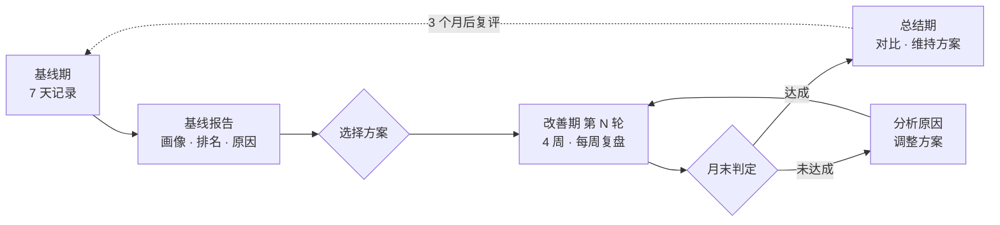

# Pulse 三阶段健康计划：设计方案（草案）

状态：设计草案，2026-11-07。医学内容取自公开的指南和论文（见文末参考文献），**上线给真实用户之前，需要医生或运动医学专业人员审核**。

---

## 1. 概览

用户的使用过程分三个阶段：

- **基线期（第 1 周）**：记录 7 天，建立「健康画像」和「行为习惯画像」，生成一份完整的健康解读，推荐一个改善方案。
- **改善期（每轮 4 周，每周复盘）**：按选定的方案执行。每周根据完成情况和身体反应调整下一周。
- **总结期**：和基线对比，留下维持方案。一轮没达标，就带着调整进入下一轮。

### 设计原则

1. **方案从实际出发。** 起点用基线期实际做到的量，而不是用户自己填的「每周运动多少分钟」。
2. **排名只是看清位置。** 每个排名都注明参考人群、数据是实测还是手表估算。没有可靠人群数据的指标不排名，只和自己比。
3. **原因只说「可能」。** 用户自己的数据能支持的，说出依据；数据查不到的，标为常见原因；可能是疾病引起的，请用户找医生排查。不下诊断。
4. **安全优先。** 出现危险信号，先就医，期间只开放基础层。已有心血管病、肾病、糖尿病等情况的用户，继续沿用 Pulse 现有的强度上限和照护规则。
5. **一个月同时看行为和早期信号。** 很多生理指标 4 周内变化有限，所以每轮同时设「做到了什么」（行为目标）和一个 4 周内能看到变化的主靶点。

---

## 2. 基线期

### 2.1 时长和开始方式

- **新用户**：完成引导后开始，记录 7 天。第 7 天数据不够时，最多延长到 14 天；仍然缺的项目在报告里写「数据不足」，不猜。
- **已有数据的用户**：最近 14 天的数据已经满足 2.2 的条件，就直接生成报告；也可以选「重新记录一周」。
- **基线期怎么安排**：照常过日子，计划页给一份「摸底周」：
  - 保持平时的运动和作息，不要刻意多练，否则基线不准；
  - 做 1–2 次 20 分钟以上的户外快走或慢跑（戴 Apple Watch），让手表估算心肺能力；
  - 可选：做一次力量自测（俯卧撑或 30 秒坐站）；
  - 用体脂秤的话，早上起床、排便后、空腹称 2 次以上。
- **今日页的进度**：不加新卡片，在「现在」卡片里显示「基线期第 3/7 天 · 还差 1 次户外快走」。报告生成后，「现在」卡片换成「基线报告已生成」。

### 2.2 需要哪些数据

**必需**（缺了就延长基线期）：

- 睡眠 ≥ 5 晚，晨起静息心率 ≥ 5 天，戴表的步数 ≥ 5 天；
- 至少 1 次心肺能力估算（VO2max）。

**有就用**：

- 体脂秤：体重、体脂率、去脂体重；
- 家庭血压：有高血压、或想改善心血管的用户，按 7 天家庭血压测量方案（早晚各测 2 次）；
- CGM：戴满 7 天以上（14 天更能代表日常）；

体脂秤、血压计、血压手表、CGM 的数据都从 Apple 健康自动读取，前提是厂商 App 打开了「写入 Apple 健康」。基线期第 1 天，Pulse 检查每类数据有没有进来，并显示来源（例如「血压：来自 OMRON connect」）。用户说有设备、但 Apple 健康里一直没有数据时，提示他去厂商 App 里打开 Apple 健康同步；厂商 App 不支持的，再退回手动录入。
- 化验：糖化血红蛋白、血脂、血红蛋白、肾功能；
- 自测：俯卧撑、30 秒坐站。

**基础信息补充**（约 2 分钟问卷，基线期任何一天填）：

- 运动前安全问题：参照 PAR-Q+ 的 7 个问题，比如「医生是否说过你有心脏问题」「运动时是否胸痛」「最近是否因为头晕失去平衡或失去意识」；
- 是否吸烟；直系亲属是否有早发心血管病（男 55 岁、女 65 岁之前）；
- 喜欢、常做的运动（多选：跑步、骑行、游泳、网球、羽毛球、乒乓球、篮球、足球、力量、瑜伽、徒步、跳舞……），每项的水平（刚开始 / 常练 / 比赛）；
- 有没有想准备的赛事：名称、日期、项目。

### 2.3 健康画像：四项能力

**心脏健康**

- 静息心率：同龄同性别排名。
- 心率变异性（HRV）：只和自己比，并给出同龄人的大致范围。Apple Watch 的 HRV 是短时测量的 SDNN，和人群研究里的测量方式不同，不做排名。
- 心律：手表的不规则心律通知、房颤负荷、心电图结果。只分「未见提示」和「有提示，建议就医」两种。
- 心率恢复（运动结束后 1 分钟心率下降多少）：正常或偏慢。
- 血压（测了才有）：按《中国高血压防治指南》分类。

**心肺与运动能力**

- 最大摄氧量（VO2max，手表估算）：同龄同性别排名，加一个「心肺年龄」：你的 VO2max 相当于哪个年龄段的中等水平。
- 肌肉力量（自测，可选）：同龄同性别排名。
- 日常活动量：日均步数、每周中高强度运动分钟，和指南比较，并说明在「步数越多、风险越低」这条曲线上处在哪一段。

**代谢健康**

- BMI、腰围：按中国成人标准分类。
- 体脂率：同龄同性别排名，注明体脂秤的误差。
- 血糖：没有糖尿病的，和健康人的 CGM 数据比；有糖尿病的，按国际 TIR 共识的目标看。化验有糖化血红蛋白就一起看。

**睡眠与恢复**

- 睡眠时长：成人每晚 7 小时以上。
- 规律性：入睡时间的波动，工作日和周末的差别。
- 夜间呼吸：呼吸紊乱次数、血氧，结合 Pulse 已有的 STOP-Bang 问卷。

### 2.4 行为习惯画像

- **日常活动**：日均步数、工作日和周末的差别、一天中哪几个小时走得多、久坐（每小时是否起身）。
- **运动时机**：早晨（5–9 点）、上午、午间（11–14 点）、下午、傍晚（17–20 点）、晚上（20 点以后），以及**饭后**（饭后 2 小时内开始的活动）。饭点用用户记录的用餐时间；没有记录但戴着 CGM，就用血糖开始上升的时间推断（45 分钟内升高 1.5 mmol/L 以上）；两者都没有，报告写「没有饭点记录」，不按常见饭点去猜。
- **运动项目**：每种运动每周几次、每次多久、常在哪几天。
- **运动强度**：每周中等强度和高强度各多少分钟（按心率区间算），离每周 150 分钟还差多少。
- **运动中的心脏表现**，按项目分别看：
  - 平均心率是最大心率的百分之几、高强度时间有多长、最高心率；
  - 运动后的心率恢复；
  - 跑步、骑行：同样配速下的心率（以后用来看体能是否进步）；
  - 轻松训练时心率是否过高（「想慢练，其实练成了中高强度」）。
- **生活方式**：饮酒、咖啡因、晚饭时间、上床时间（Pulse 已有这些记录）。

### 2.5 基线报告的内容

1. **一句话总结**：最强的一项、最需要改善的一项、推荐的方案。
2. **健康画像**：四张能力卡片。每张卡片包括：等级、同龄同性别排名条、关键数字、一句话解释，以及数据说明（实测还是估算、参考的是哪群人）。
3. **行为习惯**：活动时钟（24 小时的活动分布）、运动项目、运动中的心脏表现。
4. **需要关注**：排名靠后、没达标的项目，每项附可能原因（见 2.7）。
5. **推荐方案**：推荐 1 个，并列出其他可选方案，各附一句理由。
6. **需要先就医的情况**（有才显示）。
7. **说明**：这不是诊断；排名所用的人群；手表和体脂秤的误差。

报告生成后保存为快照，以后数据更新也不会改动它。总结期就拿这份快照来对比。

### 2.6 排名怎么算

- 按年龄段（20–29、30–39 … 70 岁以上）和性别查参考表，算出百分位，分 6 档显示：
  - 前 10%（P90 以上）、前 25%（P75–90）、中上（P50–75）、中下（P25–50）、后 25%（P10–25）、后 10%（P10 以下）；
  - 档位旁边写一个约数，比如「约前 30%」。
- 参考人群：同龄同性别是主要排名。「全人群排名」大部分差别来自年龄，对用户帮助不大，所以用「心肺年龄」表达和所有年龄的人相比的位置。
- 每个指标都标数据质量：实测、估算、数据不足。
- 各指标所用的参考表和来源见 **附录 A**。

### 2.7 可能原因怎么推测

排名在后 25% 或没达标的项目，逐个检查候选原因。每个原因标一个依据等级：

- **有数据支持**：用户自己的数据能看到。例：「基线期每周中高强度运动只有 40 分钟」。
- **常见原因**：研究中常见，但数据核实不了。例：遗传。
- **需要医生排查**：不能排除是疾病引起的。例：贫血、甲状腺问题。

每项最多列 3 个原因，按依据等级排序。措辞用「可能和……有关」，不用「因为」。用户自己数据里的关联（Pulse 已有的关联分析）可以直接引用，例如「你的记录里，喝酒后第二天的静息心率平均高 4 次/分」。

| 项目 | 候选原因（检查什么） |
|---|---|
| VO2max 偏低 | 中高强度运动少（基线期分钟数）；体重或体脂偏高（VO2max 按体重计算）；手表估算样本少（户外快走/跑次数）；服用 β 受体阻滞剂（影响按心率估算的结果）；血红蛋白低（化验）→ 医生；心肺疾病 → 医生 |
| 静息心率偏高 | 有氧基础弱（VO2max、运动分钟）；睡眠不足（平均睡眠时长）；饮酒、晚间咖啡因（记录和关联）；压力大（晨起评估）；天热或喝水少；最近生病；甲状腺功能、贫血 → 医生（持续 > 100 次/分时提示） |
| 心率变异性偏低 | 和静息心率偏高的原因相同；另外 HRV 随年龄下降，单次偏低意义有限 |
| 心率恢复偏慢 | 体能基础弱；用药；数据来自强度很低的运动，结果不可靠；持续偏慢 → 医生 |
| 体脂率、腰围偏高 | 活动量少（步数、运动分钟）；力量训练少；晚饭晚或吃夜宵（记录）；饮酒；睡眠短 |
| 血糖餐后偏高 / 波动大 | 饭后不活动（饭后 2 小时步数）；晚饭晚；高碳水餐（饮食记录）；睡眠不足；体脂偏高；夜间低血糖且使用胰岛素或磺脲类 → 医生 |
| 睡眠不足 / 不规律 | 上床晚、工作日和周末作息差大；下午以后喝咖啡；饮酒；轮班；呼吸紊乱多 → 结合 STOP-Bang 提示睡眠呼吸暂停的可能 |
| 步数少 | 久坐的工作（工作日步数明显少于周末）；通勤方式；轮班；天气 |
| 血压偏高 | 活动量少；体重；饮酒；口味偏咸（饮食记录）；睡眠短或可能有睡眠呼吸暂停；测量方法不规范（提示按 7 天方案重测） |

### 2.8 推荐哪个方案

1. 有危险信号（见 2.9）→ 先就医，只开放基础层。
2. 有 8–26 周内的赛事（或目标里选了赛事）→ **关键事件准备**。
3. 其余情况，**最弱的那项能力决定推荐**：
   - 代谢健康最弱（BMI ≥ 28；或 BMI ≥ 24 且腰围超标；或血糖异常；或已有糖尿病前期、糖尿病）→ **代谢改善**；
   - 心脏健康最弱（家庭血压 ≥ 135/85；静息心率在后 25%；心率恢复偏慢；或已有高血压等心血管情况）→ **心血管改善**；
   - 睡眠最弱（平均每晚不到 7 小时，或入睡时间每天相差超过 60 分钟）→ **睡眠改善**；倒班、疑似或未治疗的睡眠呼吸暂停先不推荐（见 3.7）；
   - 心肺与运动能力最弱（VO2max 在后 50%），或几项都在中上以上 → **运动能力提升**。
4. 同时符合好几个时，推荐排名最低的一项，第二项作为备选；一样低时按心血管、代谢、睡眠、运动能力的顺序。
5. 用户可以选任何方案，前提是安全规则允许（例如心血管情况没有医生确认时，不能选含高强度间歇的方案）。

### 2.9 危险信号

- 运动时胸痛、胸闷、晕厥、不明原因的气短 → 先就医。
- 手表出现不规则心律通知，或有房颤负荷 → 就医确认后，才安排高强度训练。
- 家庭血压平均 ≥ 160/100 → 先就医，期间只做步行等低强度运动；单次 ≥ 180/110 → 当天不运动。收缩压 > 160 时不做高强度运动（ESC 2020；《中国高血压防治指南（2024 年修订版）》）。
- 静息心率持续 > 100 次/分，或 < 40 次/分且有不适。
- 糖尿病用户频繁低于 3.0 mmol/L。
- PAR-Q+ 任何一题回答「是」→ 建议先咨询医生，期间可以做基础层。
- 用户确认「医生已看过」后可以开始方案。这个确认按危险信号分别记下：之后出现新的危险信号，要再确认一次；它也只用于开始方案，心血管、肾病的强度上限仍按 Pulse 原有的「医生确认的运动强度」设置。

---

## 3. 方案包

### 3.0 每个方案的结构

- **主靶点**：这一轮最想改善的 1 个指标，改善期显示在首页（见 3.1）。
- **辅助指标**：一起观察、但不作为判定依据的 2–3 个指标。
- **行为目标**：2–3 个，例如每周中高强度分钟、力量次数、饭后散步次数。
- **基础层**：所有方案共用，见 3.2。
- **核心层**：方案的主要训练，4 周逐步加量。
- **进阶层**：根据用户常做的运动设计，见各方案。
- **安全与调整**。

### 3.1 主靶点

每个方案的主靶点不同。运动能力提升固定看最大摄氧量；心血管改善和代谢改善按用户的身体状况选。

**怎么选**：主靶点要同时满足三条：

1. 是用户这个方向上最需要改善的指标；
2. 至少每周能测到一次；
3. 4 周内有机会变化，而且变化能超过正常的日常波动。

用户没有需要的设备（比如没有血压计、没戴 CGM）时，选下一个能测的指标，并提示他添置设备后可以改用更合适的靶点。每一轮内主靶点不变，下一轮可以换：例如血压已经达标，下一轮改看静息心率。

**各方案的主靶点**：

- **运动能力提升** → 最大摄氧量（VO2max，手表估算）。
  - 辅助指标：固定路线快走或慢跑时的平均心率、力量自测、每周中高强度分钟。
- **关键事件准备** → 周跑量（实际 / 计划）。
  - 辅助指标：最长一次距离、轻松配速下的心率、距比赛天数。
- **心血管改善**：先看有没有血压问题，有的话再看有没有血压计。
  - 「有血压问题」指医生诊断过高血压，或者基线期测得的血压偏高（家庭血压平均 ≥ 135/85）。后一种情况同时建议去医院确认。
  - **有血压问题、有血压计** → 家庭血压（7 天平均）。
    - 读数自动进来，不用手动录入：欧姆龙等智能血压计、华为 Watch D 这类血压手表，测完会同步到手机上的厂商 App，厂商 App 再写入 Apple 健康，Pulse 从 Apple 健康读取（Pulse 现在已经读 Apple 健康里的血压）。只有不能同步的老式血压计，才需要手动录入。
    - 基线期按 7 天方案测：每天早晚各测 2 次。读数带测量时间，Pulse 自动判断早上、晚上测够了没有，不用用户自己勾。
    - 改善期每周至少测 3 天，同样早晚各 2 次。
    - 新读数同步进来后，首页的主靶点马上更新。
    - 月末用第 4 周的平均值和基线比。医生给过目标的，用医生的目标。
    - 腕式设备（如华为 Watch D）：家庭血压监测的指导建议首选上臂式电子血压计，腕式的读数受手腕位置影响大，必须按说明书的姿势测。Pulse 能从数据来源认出腕式设备时，测量提醒里附上姿势要点（坐好、手腕和心脏同高）。读数照常计入主靶点。
  - **有血压问题、没有血压计** → 主靶点仍然是血压，用在社区卫生服务中心、药店等地方测的读数，手动记下来。
    - 每周至少测 2 次，尽量在同一时段，坐着休息 5 分钟后再测。
    - 首页显示最近一次读数和日期，以及 4 周的平均值。
    - 这种读数少、波动大，月末判定要求每周都有读数，用第 3–4 周读数的平均值和基线比，而且变化要比有血压计时更明显。读数不够时，判定为「读数不足」，这一轮按行为目标评价。
    - 报告和首页都提示添置一台经过认证的上臂式电子血压计。添置后当天就改用家庭血压，主靶点还是血压，不用等下一轮。
  - **没有血压问题** → 静息心率（7 天平均）。
  - 辅助指标：静息心率（主靶点是血压时）、心率变异性、心率恢复、步行平均心率。
- **代谢改善**：
  - 有糖尿病并戴 CGM → 血糖在目标范围内的时间（TIR，3.9–10.0 mmol/L）；
  - 没有糖尿病、但 CGM 显示餐后血糖偏高 → 餐后血糖峰值，或高于 7.8 mmol/L 的时间；
  - 没有糖尿病、CGM 显示餐后血糖已在健康范围，BMI 或腰围超标 → 体重（7 天平均）；
  - 没戴 CGM、BMI 或腰围超标 → 体重（7 天平均）；
  - 没戴 CGM、体重正常，但有糖尿病或糖尿病前期 → 空腹血糖（每周至少 3 个早上测）；
  - 辅助指标：腰围、体脂率、低血糖时间（用降糖药的用户）。
- **睡眠改善**：
  - 平均每晚不到 7 小时 → 睡眠时长（7 晚平均）；
  - 已经睡够、入睡时间每天相差超过 60 分钟 → 入睡时间波动（7 晚的标准差）；
  - 辅助指标：静息心率、心率变异性、醒后精力。

各靶点的 4 周目标值见各方案（3.3–3.7）。

**首页显示**：

- 进入改善期后，今日页「今日状态」卡片右侧原来显示静息心率的位置，换成主靶点：当前值、和基线相比的变化、本轮目标，以及从基线开始的一条小趋势线。点击进入方案详情。
- 主靶点就是静息心率时，位置不变，只加上基线和目标。
- 最大摄氧量更新得慢，要户外快走或跑步之后手表才会估算。所以显示最近一次估算和日期；7 天没有新的估算时，提示「做一次 20 分钟户外快走，手表才会更新」。
- 家庭血压显示 7 天平均；当天量过的话，附上当天的读数。没有血压计的用户显示最近一次读数和日期。
- 基线期仍然显示静息心率。总结期继续显示主靶点和最终结果，直到用户开始新方案或结束计划。
- 静息心率不会消失：趋势页和晨起评估里照常有。

### 3.2 基础层（所有方案共用）

- **步数**：从基线期的日均步数开始（取整到 500），每周加 1000 步，加到你这个年龄的获益平台为止：60 岁以下 8000 步，60 岁及以上 6000 步（Paluch 2022；Ding 2025）。已经超过的，保持现在的量。
- **久坐**：坐 30–60 分钟起身活动 2–3 分钟。有糖尿病的，至少每 30 分钟起身一次（ADA 2026）。
- **睡眠**：每晚 7 小时以上，入睡时间尽量固定（AASM/SRS 2015）。规律的作息和更低的死亡风险有关（Windred 2024）。
- **力量**：每周 2 次全身力量训练（WHO 2020；《中国人群身体活动指南（2021）》）。
- **65 岁以上**：每周 3 次平衡和功能练习，比如单脚站、脚跟脚尖走（WHO 2020；世界跌倒预防指南 2022）。只靠走路预防不了跌倒。

基础层的数字写在每周计划的「计划原则」里，步数目标同时更新到今日页。

### 3.3 运动能力提升

- **适合谁**：最大摄氧量在同龄同性别的后 50%，或者目标里有「提升运动能力」。
- **主靶点**：最大摄氧量，取近两周几次估算的平均。
- **4 周目标**：比基线高 5%（至少高 1.5）；已经在同龄前 25% 的，高 3%。
  - 依据：训练后最大摄氧量约 3 周开始上升（Hickson 1981；Murias 2010）。高强度间歇和持续有氧都能提高约 5 mL/kg/min，间歇多约 1.2（Milanović 2015）。
  - 误差：手表的估算每次会浮动，中位数约 1.2，多的到 2.6（Apple 白皮书 2021），独立研究里平均偏低约 6（Lambe 2025）。所以变化超过 2.6 才说「明确在变好」，没超过的写「还在估算误差内」。
  - 测量：手表只在户外平路快走、跑步、徒步之后估算，骑车、游泳和球类都不会，所以每周至少安排 2 次户外快走或慢跑。
- **行为目标**：训练完成 75% 以上；步数达到当周目标；间歇和复测按计划完成。
- **核心层**：
  - 第 1 周：有氧打底，不安排间歇；
  - 第 2 周：1 次间歇；
  - 第 3–4 周：每周训练 4 天以上的，2 次间歇，两次不排在相邻的日子；
  - 第 4 周：一次「心肺复测」，户外快走或慢跑 20–30 分钟，路线和配速尽量和平时一样；
  - 间歇做法：4×4，即 4 分钟最大心率的 85–95% 加 3 分钟轻松，重复 4 次（Helgerud 2007）。刚开始运动的人、或最大摄氧量在后 25% 的人，改成「1 分钟快、2 分钟慢」重复 6–8 次。
- **进阶层**：
  - 常打的球类按用户自己的心率定强度：平均心率达到心率储备的 60% 以上（ACSM 的较高强度），这项运动就算他本周的高强度训练，相应少排一次间歇；达不到的算一次有氧。每周打两次的，两天都排上。
  - 喜欢跑步、骑车、游泳的，间歇就用这个项目做。
  - 依据：常打球拍类运动的人全因死亡风险低约 47%（Oja 2017，观察性研究）。单打网球约 8.0 MET，竞技羽毛球约 7.0 MET，都属于较高强度（2024 成人身体活动纲要）。
- **安全**：心血管情况未经医生确认、有强度上限、妊娠、心力衰竭的，不排间歇，计划里说明原因。服用 β 受体阻滞剂等降心率药物的，改用主观用力程度。

### 3.4 关键事件准备

- **适合谁**：2–30 周内有比赛（马拉松、半马、10 公里）。要先在「专项运动」里填好比赛名称和日期；有心血管情况、医生没确认的，不能选这个方案。
- **主靶点**：周跑量（实际 / 计划），当周完成计划的 90% 以上。计划跑量来自马拉松分期的当周跑量；基线期的周跑量只作参考，不和完成比例相减。
- **计划**：直接用 Pulse 现有的马拉松分期（打基础、加量、专项、减量），每 4 周复盘一次训练阶段，比赛结束后进入总结期。
- **规则和依据**：
  - 业余马拉松跑者的周跑量中位数约 40 公里，最长一跑约 32 公里（Fokkema 2020）；
  - 单次最长的一跑不超过过去 30 天最长那次的 110%，这比周跑量的变化更能预测受伤（Frandsen 2025）。「每周加 10%」的规则在试验中没有效果（Buist 2008）；
  - 赛前减量 2 周，跑量减 41–60%，强度和频率不变（Bosquet 2007）；
  - 比赛补给：1–2.5 小时的比赛每小时 30–60 克碳水，超过 2.5 小时最多每小时 90 克（Jeukendrup 2014）；
  - 35 岁以上先看症状和风险评估；久坐或高风险的人开始高强度训练前，建议做包括运动试验的评估（ESC 2020）。比赛中心脏骤停约每 10 万人 0.6 例，冠心病是主要原因（Kim 2025）。

### 3.5 心血管改善

- **适合谁**：有高血压，或家庭血压平均 ≥ 135/85，或静息心率在同龄后 25%，或运动后心率恢复偏慢。
- **主靶点**：按 3.1 的规则选家庭血压、社区或药店测的血压，或静息心率。
- **4 周目标**：
  - 家庭血压：第 4 周的平均收缩压比基线降 5 mmHg（有临床意义的最小变化，Lea 2024），或降到医生的目标、135 以下，取先达到的那一个；已经低于目标的，目标是保持，不会定得比基线还高；
  - 社区、药店的读数：降 10 mmHg 或到目标。单次读数误差大（Stergiou 2002；Keenan 2009），读数不够时这一轮按行为目标评价；
  - 静息心率：起点 70 以上的降 3 次/分，其余降 2 次/分。耐力训练一般能降 2.7–5.8 次/分（Reimers 2018）。
- **依据**：
  - 有高血压的人坚持耐力训练，血压平均降 8.3/5.2 mmHg（Cornelissen 2013）；
  - 网络荟萃分析中，等长训练降得最多（−8.24/−4.00），有氧 −4.49/−2.53，两者结合 −6.04/−2.54（Edwards 2023）；4 周靠墙静蹲的试验降了 4–14 mmHg；
  - 第 3 次训练起血压就开始下降（Meredith 1990）；一次有氧运动后血压低 5–7 mmHg，可持续到 24 小时（Pescatello 2015），所以多数日子都要动；
  - 《中国高血压防治指南（2024 年修订版）》：中等强度（心率储备的 40–60%），每天 30 分钟，每周 5–7 天；每天盐少于 5 克；高血压患者不应饮酒。
- **行为目标**：训练完成 75% 以上；步数达到当周目标；家庭血压每周至少测 3 天（社区、药店每周至少 2 次）。
- **核心层**：
  - 主靶点是血压：多数日子快走 30 分钟（「快走日」），每周 3 次等长练习，加上每周 2 次力量；
  - 等长练习：靠墙静蹲 2 分钟 × 4 组，组间休息 2 分钟，全程正常呼吸、不憋气（Edwards 2024）。膝关节有问题、65 岁以上、有冠心病、心衰或心律失常的，改成静力握拳，血压升得更少；
  - 主靶点是静息心率：以能说话的中低强度有氧为主，第 3 周起体能够的人加 1 次间歇。
- **进阶层**：双打网球、社交羽毛球按心率算有氧或高强度；血压 ≥ 160/100 时不做高强度。
- **安全**：家庭血压平均 ≥ 160/100 先就医；收缩压 > 160 时不做高强度运动；做力量时不憋气（ESC 2020）。

### 3.6 代谢改善

- **适合谁**：BMI ≥ 28；BMI ≥ 24 且腰围超标；血糖或糖化血红蛋白偏高；已有糖尿病前期或糖尿病。
- **主靶点**：按 3.1 的规则选血糖达标时间、餐后血糖、体重或空腹血糖。
- **4 周目标**：
  - 体重：7 天平均降 2%，大约每周 0.5–1 公斤；
  - 血糖达标时间（有糖尿病，戴 CGM）：提高 5 个百分点，最多到 70%；已经在 70% 以上的，目标是保持。达标时间每提高 10 个百分点，糖化血红蛋白约降 0.5–0.8%。要有 14 天、70% 以上佩戴时间的数据才算数（Battelino 2019）；
  - 餐后血糖（没有糖尿病，戴 CGM）：高于 7.8 的时间减少三分之一，或降到健康成人常见的范围：60 岁以下 3.9% 以内，60 岁及以上 8.6% 以内（Shah 2019）；已经在这个范围内的，目标是保持，不会定得比基线还高；
  - 空腹血糖：降 0.5 mmol/L；
  - 糖化血红蛋白 4 周看不出变化，相关研究都在 8 周以上。
- **依据**：
  - ADA 2026：每周 150 分钟以上，至少分 3 天，连续不运动不超过 2 天；力量每周 2–3 次，不在相邻的日子；至少每 30 分钟起身一次；减重 5–7%；
  - 每次饭后走 10 分钟，比一天走一次 30 分钟效果更好，晚饭后尤其明显（Reynolds 2016）；用轻松走路打断久坐，餐后血糖平均低约 17%（Buffey 2022）；
  - 《中国 2 型糖尿病运动治疗指南（2024 版）》：运动前血糖低于 5.6 先吃碳水；用胰岛素或磺脲类时，饭后约 1 小时再运动；血糖高于 13.9 先查酮体，酮体阳性不做中等以上强度的运动。
- **行为目标**：训练完成 75% 以上；步数达到当周目标；每周至少 5 天晚饭后散步（按 19–21 点的步数或饭后散步记录判断）。
- **核心层**：每天晚饭后 15–30 分钟出门走 10–15 分钟（「饭后散步」）；训练能安排在饭后 1 小时内更好；每周 2–3 次力量；第 3 周起体能够的人加 1 次间歇。
- **进阶层**：晚饭后打羽毛球、网球也算数，强度按心率判断。
- **安全**：沿用 Pulse 现有的运动前血糖检查和随身带糖提醒；增殖期视网膜病变的人不做剧烈或力量训练（ADA 2026）。

### 3.7 睡眠改善

2026-11-09 加上。睡眠原来只在基础层里（每晚 7 小时以上、入睡时间尽量固定），这个方案给睡眠不够或作息很乱的人单独一轮。

- **适合谁**：平均每晚睡不到 7 小时（AASM/SRS 2015；中国全国爱卫办 2025 建议成年人 7–8 小时），或入睡时间每天相差超过 60 分钟（7 晚入睡时间的标准差）。睡得够、作息也稳的人也可以选，只是不会推荐。
  - 60 分钟是 Pulse 的取舍，不是公认标准：NSF 2023 共识认为现有证据定不出一个固定数字。MESA 研究里，入睡时间标准差 31–60 分钟的心血管风险是 30 分钟以内的 1.16 倍，61–90 分钟 1.52 倍（不显著），90 分钟以上 2.11 倍（Huang 2020）。
- **先看医生、不开始方案**：
  - 倒班：作息由排班决定，「固定起床时间」做不到，倒班的睡眠建议在「倒班 / 轮班作息」里；
  - 夜间呼吸线索多（打鼾、憋醒、被看到呼吸暂停、夜间血氧低）、STOP-BANG 自评 5 分以上、疑似睡眠呼吸暂停，或已确诊但还没治疗：先请医生评估和治疗。多躺在床上解决不了呼吸暂停带来的困倦；治疗后（正压通气等）可以开始。
    - STOP-BANG ≥ 3 分能找出 93% 的中重度呼吸暂停，但特异度只有 25–49%（Chung 2016；Nagappa 2015），所以 3–4 分不单独拦，5 分以上（自评里的「较高风险」）才拦。AASM 的标准是白天困倦再加上响亮打鼾、被看到呼吸暂停或憋醒、高血压中的 2 项（Kapur 2017）。
    - Apple Watch 的睡眠呼吸暂停通知能发现 66% 的中重度病例（中度 43%、重度 89%），没有通知不代表没有呼吸暂停（Apple 2024）。
  - 新生儿父母没有单独的字段，计划里不区分；产后头 3 个月母亲平均少睡约 1 小时（Richter 2019），这时睡眠时长目标意义不大，用户可以选别的方案。
- **主靶点**：
  - 平均每晚不到 7 小时 → **睡眠时长**（7 晚平均，至少 3 晚有记录）；
  - 已经睡够 7 小时、作息乱 → **入睡时间波动**（7 晚入睡时间的标准差，至少 4 晚有记录）。
- **4 周目标**：
  - 睡眠时长：多睡半小时，最多到 7 小时；已经 7 小时以上的保持；
  - 入睡时间波动：少 20 分钟，最低到 30 分钟（30 分钟以内算作息规律）；已经在 30 分钟以内的保持。
  - 依据：睡得少的人延长睡眠，4–6 周的试验里每晚多睡 21–47 分钟，荟萃分析 +51 分钟（Zhu 2022；Al Khatib 2018；Haack 2013；Leproult 2015），个体差异大，所以定半小时。作息规律更难改：延长睡眠和个性化反馈都没让规律性明显变好（Stegman 2026；Windred 2021），还没有提高规律性的成人随机试验，20 分钟是 Pulse 的取舍，需要专业人员审核。
  - 正常波动：同一个人每晚睡多久的标准差约 77 分钟（Messman 2022）。按这个估算（Pulse 自己的计算），一周的 7 晚平均和基线相差 45 分钟以上才算超出平时的波动；第 4 周结束时用第 3–4 周两周的平均，更稳一些。只用 7 晚算出的标准差本身有约 ±29% 的误差，入睡时间波动相差 20 分钟以内算正常波动。
  - 手表：和多导睡眠图比，Apple Watch 每晚多算 8–20 分钟睡眠，入睡时间比较准（Schyvens 2025；Robbins 2024）。偏差大致固定，看自己前后的变化影响不大。
- **核心层**：
  - 起床时间固定在基线期的平均起床时间（取整到 15 分钟），周末不晚于平时 1 小时；
  - 睡眠时长是主靶点时，上床时间从基线期的平均入睡时间开始，每周提前 15 分钟，提前到能睡够 7 小时为止；
  - 入睡时间波动是主靶点时，上床时间固定在基线期的平均入睡时间前后半小时；
  - 躺下 20 分钟还睡不着就起来做点放松的事，困了再回床（刺激控制）；65 岁以上或关节不好的，夜里起来时先坐一会儿、开一盏小灯再走（AASM 2021 提醒跌倒风险）；
  - 训练照常：规律运动能改善主观睡眠质量（PSQI 约降 2 分），但手表测的睡眠时长变化不大（Xie 2021）；晚上运动不影响睡眠，只是剧烈运动最好在睡前 1 小时以前结束（Stutz 2019，证据还少）。
- **习惯**（只靠讲睡眠卫生知识，手表测的睡眠基本不变，Chung 2018；所以和固定作息一起做）：
  - 咖啡：一杯咖啡（约 107 mg 咖啡因）要在睡前 8.8 小时以前喝完，按 23 点睡就是下午 2 点前；红茶没有找到需要截止的时间（Gardiner 2023）。Pulse 用档案里的咖啡因截止时间，默认 14 点；
  - 酒：两杯左右就会减少快速眼动睡眠，喝得越多越明显（Gardiner 2025）；找不到「睡前几小时」的依据，所以只说晚上尽量不喝；
  - 小睡：每天 30 分钟以内没有发现和心血管风险有关，60 分钟以上风险升高（Yamada 2015；Sun 2022）；
  - 光线：白天多接触亮光（≥ 250 lux），睡前 3 小时起把灯调暗（Brown 2022）；
  - 屏幕：上床后每多看一小时屏幕，睡眠约少 24 分钟（Hjetland 2025，横断面研究）。
- **行为目标**：训练完成 75% 以上；步数达到当周目标；每周至少 5 天在固定起床时间前后半小时内醒来；至少 5 晚按时睡着（睡眠时长靶点：不晚于当周上床时间 30 分钟；波动靶点：在固定上床时间前后半小时内）。按手表记录的入睡、醒来时间判断。
- **失眠**：每周至少 3 晚入睡困难、夜里醒来难再睡或醒得太早，持续 3 个月以上，并且影响白天，就是慢性失眠（ICSD-3）。首选治疗是失眠认知行为治疗（CBT-I）（ACP 2016；AASM 2021；欧洲失眠指南 2023；《中国成人失眠诊断与治疗指南（2017 版）》）；数字化 CBT-I 也有效，效果比面对面的稍弱（Soh 2020）。
  - 延长卧床时间和 CBT-I 的核心（睡眠限制）方向相反，所以有失眠的人不应该用这个方案提前上床。Pulse 没有失眠的诊断字段，每周计划里写明：符合上面的情况先别再提前上床，去睡眠门诊。
  - Pulse 不做睡眠限制疗法：它头几周会让人更困，司机、操作机器的人、有躁狂倾向或癫痫的人需要专业人员调整（AASM 2021；Kyle 2014）。
- **月末**：计划做到了、睡眠还没到目标时，下一轮起床时间不变，上床时间再提前 15 分钟（睡够 7 小时为止），目标不变。连续 3 轮没达到，建议带着记录去睡眠门诊。

---

## 4. 个性化规则

方案包给出框架，下面这些规则决定每个人具体练什么、练多少。

**年龄**

- 最大心率：用 208 − 0.7 × 年龄估算（Tanaka）。基线期运动中出现过更高的心率，就用实测值。
- 心率区间：用心率储备法（Karvonen），静息心率取基线期的值。中等强度 = 心率储备的 40–59%，较高强度 = 60–89%（ACSM，Garber 2011）；《中国高血压防治指南》也用 40–60%。
- 步数目标：60 岁以下 8000–10000 步，60 岁及以上 6000–8000 步，这是步数和死亡风险曲线变平的位置（Paluch 2022）；7000 步和 2000 步相比，全因死亡风险低约 47%（Ding 2025）。
- 加量速度：每周总量增加不超过约 10%。60 岁以上、刚开始运动的人更慢。
- 65 岁以上：每周 3 次平衡和功能练习；间歇训练改成温和版本，比如「快走 1 分钟、慢走 2 分钟」。

**健康状况和用药**

- 沿用 Pulse 现有的限制：心血管情况未经医生确认、强度上限、慢性肾病未经确认、透析日、妊娠等。受限时不安排高强度间歇，核心层改成中等强度。
- 医生给的运动心率上限优先于所有公式。
- 服用 β 受体阻滞剂等控制心率的药：心率区间不可靠，改用主观用力程度（RPE）和说话测试。
- 糖尿病并使用胰岛素或磺脲类：沿用 Pulse 现有的运动前血糖检查和随身带碳水的提醒。
- 关节问题：用骑行、游泳、椭圆机等低冲击运动替代跑跳。

**基线期的习惯**

- 起点：基线期实际的运动分钟和步数。第 1 周只比基线多约 10%。
- 时间：训练排在用户平时常运动的日子和时段。基线显示用户总在晚上运动，计划就不排早晨。
- 项目：用户喜欢的运动放进进阶层，替代同等强度的常规训练。每周打两次网球的人，网球就是他的高强度训练，不必另外跑间歇。

**运动中的心脏表现**

- 每个项目按用户自己的心率定强度。同样打羽毛球，有人是中等强度，有人是高强度。平均心率在较高强度区间、持续 20 分钟以上，才算高强度。
- 轻松训练时心率经常超过中等强度上限 → 放慢配速，或改成走跑交替。
- 心率恢复偏慢 → 前两周只练有氧基础，第 3 周再考虑间歇。
- 运动中超过医生给的心率上限 → 当天提醒，并在周复盘里提出来。

**每天的身体状态**

- 沿用 Pulse 现有的身体准备度。当天准备度低时，高强度训练换成轻松训练或休息，这一次不算没完成。

## 5. 改善期：每周复盘和调整

**本周复盘最上方加「方案进度」**：

- 第几周（例如「第 2/4 周」）；
- 每个行为目标是否达成，附数字；
- 主靶点：本周 7 天平均和基线、本轮目标比，超过正常波动才说「变好」或「变差」；
- 下周怎么调：加量、保持或减量，附一句理由。

**加量规则**（沿用 Pulse 现有周目标的思路）：

- 完成 ≥ 85%，且准备度没有连续偏低 → 下周加约 10%，或把一次轻松训练换成间歇（方案允许时）；
- 完成 60%–85% → 保持；
- 完成 < 60% → 减约 15%，并把训练挪到用户最常运动的时段，或换成他喜欢的项目；
- 生病、出差、受伤的一周不计入判定，这一轮可以顺延一周，每轮最多顺延 2 周。

**一起复盘**（已有）加一个问题：「这周最难坚持的是哪一项？」答案用于下周调整和月末分析。

## 6. 月末判定和下一轮

第 4 周结束（或顺延后的最后一周）时判定：

- **达成**：4 周里至少 3 周达成行为目标，并且主靶点达到本轮目标 → 进入总结期。
- **做到了，但结果还没出来**：不同指标见效的时间不同：家庭血压几周内就会降（第 3 次训练起，Meredith 1990），最大摄氧量约 3 周开始上升（Hickson 1981），静息心率要几个月，糖化血红蛋白要 8 周以上。下一轮保持行为目标，适度加强核心层（例如多一次间歇），主靶点和目标不变。
- **没做到**（完成率 < 60%）：下一轮先降低门槛，把训练放到用户最容易坚持的时段和项目，主靶点目标不变或降一档。
- **想换方案**：可以。基线快照不变，新方案用当前数据重新定起点。
- **连续 3 轮没达成**：建议重新做一次基线评估或调整目标；主靶点是血压、血糖时，建议带着记录去看医生。

关键事件准备不一样：它按比赛日期走，每 4 周的复盘只用来检查训练阶段，比赛结束后进入总结期。

## 7. 总结期

- **总结报告**：沿用基线报告的结构，逐项对比基线和现在：数字、排名档位、行为习惯（步数、运动时段、运动项目）的变化。
- **主靶点**：基线 → 现在 → 本轮目标，是否达成。
- **哪些做法有效**：引用用户数据里的关联，比如「饭后散步的日子，餐后血糖峰值低 1.2」。只说关联，不说因果。
- **维持方案**：基础层 + 每周 2–3 次核心训练，强度保持，不再加量。
- **下一步**：选新的方案，或 3 个月后复评（重新记录 7 天，生成新报告并对比）。

## 8. 和现有 Pulse 的关系

- **引导**：保留。「目标」一步的选择作为推荐方案的参考，方案本身在基线报告之后选。
- **专项模块**（专项运动、心血管健康、血糖管理）：保留，它们是照护工具。选心血管改善且有高血压时，提示打开「心血管健康」；关键事件准备直接用「专项运动」里的马拉松分期、配速和补给计划。
- **周计划**：方案生成每周计划，写入现有的计划条目，今日、计划页、调整计划、训练检查都照常工作。
- **身体准备度、训练检查**：不变，每天照常调整当天的训练。
- **本周复盘**：加「方案进度」（第 5 节）。
- **长期复盘的「所处阶段」**：建议换成三阶段进度（基线期 → 改善期第 N 轮 → 总结期），旧的按目标划分的阶段停用。照护类阶段里「需要先找医生」的步骤并入方案的安全规则。
- **静息心率基线**：现有算法（前 14 个可比较早晨的中位数）保留，基线报告用同一个数。
- **Health Agent**：增加「我的排名为什么靠后」「我现在第几周」「这周方案完成得怎么样」这类问答，答案来自规则，不让模型编数字。
- **首页**：不加新卡片。基线期的进度放在「现在」卡片里（见 2.1）；改善期起，「今日状态」里静息心率的位置换成方案的主靶点（见 3.1）。

## 9. 实现方案

**数据补齐**

- HealthKit 新增读取：体脂率、去脂体重、腰围、运动后 1 分钟心率恢复、步行平均心率、房颤负荷、站立时间、心电图分类；基线期按小时读取步数。
- 数据来源：记下每类数据来自哪个 App 和设备，用于显示「来自 OMRON connect」、认出腕式血压设备、提示用户打开同步。
- 及时更新：对血压、体重（新读数立即）和血糖、最大摄氧量（最多每小时一次）注册 Apple 健康的后台更新通知（HealthKit 后台交付权限，2026-11-09 加上）。新读数写入后 Pulse 即使没打开也会被唤醒同步，首页主靶点跟着更新；打开了「异常提醒」时，需要联系医生的读数会马上推送通知。手机锁着时健康数据读不到，要等解锁后的下一次检查或打开 App。
- 运动项目细分：现在网球、羽毛球、乒乓球、篮球、足球都记作「球类」。改为分别记录，旧记录保持「球类」。
- 运动中的心率区间：读取基线期每次运动的心率样本，算出各区间的时长。
- 用户资料新增：喜欢的运动和水平、是否吸烟、家族史、PAR-Q+ 答案。

**新的数据模型**

- 方案状态（放在用户资料里）：当前阶段、基线开始日、当前方案、第几轮、本轮开始日。
- 评估快照：基线报告、轮次总结、总结报告，存为快照，不随数据更新而变化。
- 方案轮次：每一轮的方案、目标、每周结果和月末判定。

**新的引擎**（放在 Engine/，都是纯函数，方便测试）

- PopulationNorms：附录 A 的参考表和百分位计算。
- BaselineAssessment：健康画像、行为习惯画像、数据完整度。
- CauseInference：2.7 的原因推测。
- PackCatalog：五个方案的定义（目标、各层、安全规则）。
- PackPlanner：方案 + 个性化规则 → 每周计划，交给现有的 PlanGenerator 写入。
- ProgramEvaluator：每周进度、月末判定、阶段切换。

**新的页面**

- 今日状态卡片：改善期右侧显示主靶点（数值、基线、目标、趋势线）；
- 基线报告、选择方案、方案详情（从计划页顶部和首页主靶点进入）、轮次总结、总结报告；
- 我的 › 方案：当前方案、历史报告、重新评估。

**分步实现**（每步单独提交，都带测试）

1. 数据补齐：HealthKit 新类型、运动项目细分、资料新字段。
2. 基线评估：参考表、健康画像、行为习惯、原因推测、方案推荐。
3. 基线报告页和方案选择页。
4. 方案包、主靶点和个性化周计划；首页主靶点，计划页顶部的方案进度。
5. 本周复盘的方案进度、月末判定、下一轮、总结期。
6. 示例用户（新增一位常打网球的用户）、Health Agent 问答、演示截图。

**实现状态（2026-11-09）**：第 1–6 步都已完成并有测试。按规格复核后补齐了：摸底周计划、力量自测和排名、训练排在常运动的日子和时段、65 岁以上的温和间歇、心率恢复偏慢时前两周只练有氧、生病出差的周顺延（每轮最多 2 周）、连续 3 轮没达成时建议重新评估、一起复盘里的「这周最难坚持的是哪一项」、关键事件准备按比赛日期走、换方案时基线快照不变、总结报告快照和「哪些做法有效」、维持期不再加量、今日页「现在」卡片里的基线期进度、添置血压计当天改用家庭血压、Health Agent 的方案问答、血压等数据的更新通知（App 打开时）。

## 10. 已确认的决定

2026-11-07 和你确认：

- 已有数据的用户：最近 14 天的数据够，就直接生成基线报告，也可以选择重新记录一周。
- 长期复盘的「所处阶段」换成三阶段进度，旧的按目标划分的阶段停用。
- 排名以同龄同性别为主，另给「心肺年龄」。
- 方案包先做 4 个。睡眠放在所有方案的基础层，并在基线报告里分析原因。2026-11-09 加上第 5 个「睡眠改善」（见 3.7）。
- 关键事件准备的主靶点用周跑量。
- 代谢改善的主靶点按 3.1 的建议。
- 心血管改善先看有没有血压问题：有的话看血压，并区分有没有血压计；没有血压问题的，看静息心率。
- 华为 Watch D、欧姆龙（国内版和海外版 App）的血压都能同步到 Apple 健康，Pulse 能自动读到。
- 按第 9 节的顺序开始实现。

## 附录 A：人群参考表

完整的数值在 `Pulse/Engine/PopulationNorms.swift`，下面是来源和用法。

**有人群排名的指标**（P10 / P25 / P50 / P75 / P90）

最大摄氧量（mL/kg/min），FRIEND 2022，美国健康成人跑步机实测（Kaminsky 2022）：

| 年龄 | 男 | 女 |
|---|---|---|
| 20–29 | 28.8 / 37.3 / 45.4 / 52.6 / 57.8 | 22.2 / 28.6 / 35.6 / 42.2 / 47.3 |
| 30–39 | 25.0 / 31.3 / 38.6 / 46.5 / 54.3 | 19.2 / 23.1 / 28.3 / 34.5 / 41.1 |
| 40–49 | 22.9 / 28.4 / 34.8 / 41.8 / 49.5 | 17.4 / 21.3 / 25.9 / 30.9 / 37.5 |
| 50–59 | 19.2 / 23.9 / 29.4 / 35.5 / 42.7 | 16.6 / 19.5 / 23.1 / 27.3 / 31.8 |
| 60–69 | 16.1 / 19.7 / 24.4 / 29.9 / 36.4 | 13.5 / 16.4 / 19.4 / 23.1 / 27.3 |
| 70–79 | 13.6 / 16.8 / 20.6 / 25.0 / 29.6 | 12.3 / 14.8 / 17.1 / 20.0 / 22.8 |

- 日本 23 项研究的汇总均值和这张表的中位数接近，所以用它代表东亚成人。中国唯一的样本（Wang 2022）是功率车测试、多数没测到真正的最大值，只作参考。
- 心肺年龄：在各年龄段中位数之间插值，范围 20–89 岁。

静息心率（次/分），美国 NHANES 诊室坐位脉搏（Ostchega 2011），越低排名越靠前：

| 年龄 | 男 | 女 |
|---|---|---|
| 20–39 | 55 / 61 / 69 / 76 / 84 | 60 / 66 / 74 / 82 / 89 |
| 40–59 | 55 / 61 / 68 / 77 / 85 | 59 / 64 / 71 / 79 / 86 |
| 60–79 | 54 / 60 / 67 / 75 / 84 | 59 / 64 / 70 / 78 / 86 |

- 手表的静息心率通常比诊室脉搏低，排名可能偏好一档，报告里注明。

体脂率（%），2020 年国民体质监测，中国成人，8 电极多频生物电阻抗（Tu 2025），每 5 岁一档，越低排名越靠前。例：男 40–44 岁 18.6 / 23.0 / 27.3 / 31.5 / 35.5，女 40–44 岁 22.5 / 26.2 / 30.1 / 33.9 / 37.7。

肌肉力量（自测，可选）：

- 俯卧撑（做到力竭，女性跪姿），20–69 岁：加拿大运动生理学会（CSEP）的五档分级（The Canadian Physical Activity, Fitness & Lifestyle Approach，第 3 版，2003；ACSM 运动测试与处方指南转载）。「一般、良好、很好、优秀」的下限按第 20、40、60、80 百分位换算成大致的排名。例：男 40–49 岁 10 / 13 / 17 / 25 个，女 40–49 岁 5 / 11 / 15 / 24 个。
- 30 秒坐站，60 岁及以上：美国老年人体能测试的常模（Rikli & Jones 1999），只给第 25–75 百分位的正常范围，所以只分后 25%、中间一半、前 25%。例：男 60–64 岁 14–19 次，女 65–69 岁 11–16 次。
- 60 岁以下没有坐站的可靠常模，70 岁以上没有俯卧撑的，只和自己比。

**没有可靠人群排名、用固定标准的指标**

- 心率变异性：Apple Watch 的 SDNN 没有人群常模，测量时长和时间段不同，数值能差 25–50%，只和自己比。
- 步数：没有中国成人按年龄性别的步数分布。用获益曲线分档：5000 以下久坐，5000–7000 偏少，7000 以上中等，到年龄平台（60 岁以下 8000，60 岁及以上 6000）为达到平台，12500 以上很活跃。
- BMI 和腰围：中国标准（WS/T 428-2013）。BMI 18.5 / 24 / 28；腰围男 85 / 90 厘米、女 80 / 85 厘米。
- 血糖：有糖尿病的看国际 TIR 共识（达标时间 > 70%，低于 3.9 的时间 < 4%，低于 3.0 的时间 < 1%）。没有糖尿病的和健康成人比：平均约 5.5，高于 7.8 的时间中位数约 2%（Shah 2019）；中国健康成人的上限是 24 小时平均 6.6、高于 7.8 的时间 17%（Zhou 2009）。
- 家庭血压：≥ 135/85 为偏高，和诊室 140/90 相当（《中国高血压防治指南（2024 年修订版）》）。
- 心率恢复：较高强度运动后 1 分钟降 12 次以下为偏慢（Cole 1999），只在 2 次以上较高强度运动后判断。
- 睡眠：每晚 7 小时以上（AASM/SRS 2015）。

**主靶点的正常波动**（变化超过它，才说「真的在变」）

- 家庭血压 7 天平均：9 mmHg（两周平均之差的标准差约 7，Stergiou 2002）；
- 社区、药店的单次读数：14 mmHg；
- 静息心率 7 天平均：3 次/分（Quer 2020）；
- 最大摄氧量：2.6（Apple 白皮书）；
- 体重：1 公斤；血糖达标时间：5 个百分点。

**数据最弱的地方**

1. 手表的最大摄氧量误差大约跨 2–3 档，也没有研究验证它能否准确反映同一个人的变化；中国的参考数据很少。
2. 静息心率和 HRV 没有可穿戴设备的人群百分位表。
3. 没有设备测得的中国人步数分布。
4. 家用体脂秤（尤其是脚踩式）的误差比档位还宽。
5. 健康人的 CGM 参考样本太小，不能做百分位。

## 参考文献

**指南与共识**

- WHO 2020：Bull FC, et al. World Health Organization 2020 guidelines on physical activity and sedentary behaviour. Br J Sports Med 2020;54:1451–1462.
- 《中国人群身体活动指南（2021）》编写委员会. 中华流行病学杂志 2022.
- Garber CE, et al. ACSM position stand: quantity and quality of exercise. Med Sci Sports Exerc 2011;43:1334–1359.
- Riebe D, et al. Updating ACSM's recommendations for exercise preparticipation health screening. Med Sci Sports Exerc 2015;47:2473–2479.
- Pelliccia A, et al. 2020 ESC Guidelines on sports cardiology and exercise in patients with cardiovascular disease. Eur Heart J 2021;42:17–96.
- 中国高血压联盟等.《中国高血压防治指南（2024 年修订版）》. 中华高血压杂志 2024;32(7):603–700.
- 中国高血压联盟《家庭血压监测指南》委员会. 2019 中国家庭血压监测指南.
- American Diabetes Association. Standards of Care in Diabetes—2026, Section 5. Diabetes Care 2026;49(Suppl 1):S89–S131.
- Kanaley JA, et al. Exercise/physical activity in individuals with type 2 diabetes: ACSM consensus statement. Med Sci Sports Exerc 2022;54:353–368.
- 国家老年医学中心等.《中国 2 型糖尿病运动治疗指南（2024 版）》. 中国全科医学 2024;27(30):3709–3738.
- Battelino T, et al. Clinical targets for CGM data interpretation: International Consensus on Time in Range. Diabetes Care 2019;42:1593–1603.
- Watson NF, et al. Recommended amount of sleep for a healthy adult (AASM/SRS). Sleep 2015;38:843–844.
- Hirshkowitz M, et al. National Sleep Foundation's sleep time duration recommendations. Sleep Health 2015;1:40–43.
- 全国爱国卫生运动委员会办公室.《睡眠健康核心信息及释义》, 2025（据人民日报 2025-03-21 转载）.
- Sletten TL, et al. The importance of sleep regularity: a consensus statement of the National Sleep Foundation. Sleep Health 2023;9:801–820.
- Edinger JD, et al. Behavioral and psychological treatments for chronic insomnia disorder in adults: AASM clinical practice guideline. J Clin Sleep Med 2021;17:255–262.
- Qaseem A, et al. Management of chronic insomnia disorder in adults: ACP clinical practice guideline. Ann Intern Med 2016;165:125–133.
- Riemann D, et al. The European Insomnia Guideline: an update on the diagnosis and treatment of insomnia 2023. J Sleep Res 2023;32:e14035.
- 中华医学会神经病学分会睡眠障碍学组.《中国成人失眠诊断与治疗指南（2017 版）》. 中华神经科杂志 2018;51:324–335.
- Kapur VK, et al. Clinical practice guideline for diagnostic testing for adult obstructive sleep apnea (AASM). J Clin Sleep Med 2017;13:479–504.
- Montero-Odasso M, et al. World guidelines for falls prevention and management for older adults. Age Ageing 2022;51:afac205.
- WS/T 428-2013 成人体重判定.

**人群参考**

- Kaminsky LA, et al. Updated reference standards for cardiorespiratory fitness (FRIEND). Mayo Clin Proc 2022;97:285–293.
- Ostchega Y, et al. Resting pulse rate reference data: United States, 1999–2008. Natl Health Stat Report 2011;(41).
- Quer G, et al. Inter- and intraindividual variability in daily resting heart rate. PLoS One 2020;15:e0227709.
- Tu C, et al. Body fat percentage percentile curves for adults aged 20–79 in China. Front Public Health 2025;13:1598285.
- Paluch AE, et al. Daily steps and all-cause mortality: meta-analysis of 15 international cohorts. Lancet Public Health 2022;7:e219–e228.
- Ding D, et al. Daily steps and health outcomes in adults. Lancet Public Health 2025;10:e668–e681.
- Shah VN, et al. CGM profiles in healthy nondiabetic participants. J Clin Endocrinol Metab 2019;104:4356–4364.
- Zhou J, et al. Reference values for continuous glucose monitoring in Chinese subjects. Diabetes Care 2009;32:1188–1193.
- Cole CR, et al. Heart-rate recovery immediately after exercise as a predictor of mortality. N Engl J Med 1999;341:1351–1357.
- Windred DP, et al. Sleep regularity is a stronger predictor of mortality risk than sleep duration. Sleep 2024;47:zsad253.
- Apple. Using Apple Watch to Estimate Cardio Fitness with VO2 max (white paper), 2021.
- Lambe R, et al. Validity of Apple Watch VO2max estimates. PLoS One 2025;20:e0323741.

**训练与效果**

- Milanović Z, et al. Effectiveness of HIT vs continuous endurance training for VO2max. Sports Med 2015;45:1469–1481.
- Helgerud J, et al. Aerobic high-intensity intervals improve VO2max more than moderate training. Med Sci Sports Exerc 2007;39:665–671.
- Hickson RC, et al. Time course of the adaptive responses of aerobic power and heart rate to training. Med Sci Sports Exerc 1981;13:17–20.
- Reimers AK, et al. Effects of exercise on the resting heart rate. J Clin Med 2018;7:503.
- Cornelissen VA, Smart NA. Exercise training for blood pressure: systematic review and meta-analysis. J Am Heart Assoc 2013;2:e004473.
- Edwards JJ, et al. Exercise training and resting blood pressure: network meta-analysis. Br J Sports Med 2023;57:1317–1326.
- Edwards JJ, et al. Isometric exercise training and arterial hypertension: an updated review. Sports Med 2024;54:1459–1497.
- Meredith IT, et al. Time-course of the antihypertensive effects of regular endurance exercise. J Hypertens 1990;8:859–866.
- Pescatello LS, et al. Exercise for hypertension: a prescription update. Curr Hypertens Rep 2015;17:87.
- Stergiou GS, et al. Reproducibility of home, ambulatory and clinic blood pressure. Am J Hypertens 2002;15:101–104.
- Keenan K, et al. High risk for misdiagnosis when monitoring blood pressure. BMJ 2009;338:b1492.
- Buffey AJ, et al. The acute effects of interrupting prolonged sitting time. Sports Med 2022;52:1765–1787.
- Reynolds AN, et al. Advice to walk after meals is more effective for lowering postprandial glycaemia. Diabetologia 2016;59:2572–2578.
- Knowler WC, et al. Reduction in the incidence of type 2 diabetes with lifestyle intervention or metformin. N Engl J Med 2002;346:393–403.
- Oja P, et al. Associations of specific types of sports and exercise with mortality. Br J Sports Med 2017;51:812–817.
- Herrmann SD, et al. 2024 Adult Compendium of Physical Activities. J Sport Health Sci 2024;13:6–12.
- Frandsen JSB, et al. How much running is too much? Br J Sports Med 2025;59:1203.
- Buist I, et al. No effect of a graded training program on running-related injuries. Am J Sports Med 2008;36:33–39.
- Fokkema T, et al. Training for a (half-)marathon. Scand J Med Sci Sports 2020;30:1692–1704.
- Bosquet L, et al. Effects of tapering on performance: a meta-analysis. Med Sci Sports Exerc 2007;39:1358–1365.
- Jeukendrup A. A step towards personalized sports nutrition: carbohydrate intake during exercise. Sports Med 2014;44(Suppl 1):S25–S33.
- Kim JH, et al. Cardiac arrest during long-distance running races. N Engl J Med 2012;366:130–140；JAMA 2025;333:1699.

**睡眠**

- Huang T, Mariani S, Redline S. Sleep irregularity and risk of cardiovascular events: MESA. J Am Coll Cardiol 2020;75:991–999.
- Zhu B, et al. Feasibility of sleep extension and its effect on cardiometabolic parameters in free-living settings: meta-analysis. Eur J Cardiovasc Nurs 2022;21:9–25.
- Al Khatib HK, et al. Sleep extension is a feasible lifestyle intervention in free-living adults who are habitually short sleepers. Am J Clin Nutr 2018;107:43–53.
- Haack M, et al. Increasing sleep duration to lower beat-to-beat blood pressure: a pilot study. J Sleep Res 2013;22:295–304.
- Leproult R, et al. Beneficial impact of sleep extension on fasting insulin sensitivity in adults with habitual sleep restriction. Sleep 2015;38:707–715.
- Stegman AP, et al. From yawn to dawn: a sleep extension intervention in adults with habitual short sleep duration. Sleep Adv 2026;7:zpag003.
- Windred DP, et al. Attitudes towards sleep as a time commitment are associated with sleep regularity. Behav Sleep Med 2021;19:732–743.
- Chung KF, et al. Sleep hygiene education as a treatment of insomnia: a systematic review and meta-analysis. Fam Pract 2018;35:365–375.
- Soh HL, et al. Efficacy of digital cognitive behavioural therapy for insomnia: a meta-analysis. Sleep Med 2020;75:315–325.
- Kyle SD, et al. Sleep restriction therapy for insomnia is associated with reduced objective total sleep time and impaired vigilance. Sleep 2014;37:229–237.
- Chung F, Abdullah HR, Liao P. STOP-Bang questionnaire: a practical approach to screen for obstructive sleep apnea. Chest 2016;149:631–638.
- Nagappa M, et al. Validation of the STOP-Bang questionnaire among different populations: meta-analysis. PLoS One 2015;10:e0143697.
- Apple. Estimating Breathing Disturbances and Sleep Apnea Risk from Apple Watch (white paper), 2024.
- Messman BA, et al. How much does sleep vary from night-to-night? J Sleep Res 2022;31:e13680.
- Schyvens AM, et al. A performance validation of six commercial wrist-worn wearable sleep-tracking devices. Sleep Adv 2025;6:zpaf021.
- Robbins R, et al. Accuracy of three commercial wearable devices for sleep tracking in healthy adults. Sensors 2024;24:6532.
- Gardiner C, et al. The effect of caffeine on subsequent sleep: a systematic review and meta-analysis. Sleep Med Rev 2023;69:101764.
- Gardiner C, et al. The effect of alcohol on subsequent sleep in healthy adults: a systematic review and meta-analysis. Sleep Med Rev 2025;80:102030.
- Stutz J, Eiholzer R, Spengler CM. Effects of evening exercise on sleep in healthy participants: meta-analysis. Sports Med 2019;49:269–287.
- Xie Y, et al. Effects of exercise on sleep quality and insomnia in adults: meta-analysis of RCTs. Front Psychiatry 2021;12:664499.
- Brown TM, et al. Recommendations for daytime, evening, and nighttime indoor light exposure. PLoS Biol 2022;20:e3001571.
- Hjetland GJ, et al. How and when screens are used: screen activities and sleep in Norwegian university students. Front Psychiatry 2025;16:1548273.
- Yamada T, et al. Daytime napping and the risk of cardiovascular disease and all-cause mortality: dose-response meta-analysis. Sleep 2015;38:1945–1953.
- Sun J, et al. Daytime napping and cardiovascular risk factors, cardiovascular disease, and mortality: a systematic review. Sleep Med Rev 2022;65:101682.
- Richter D, et al. Long-term effects of pregnancy and childbirth on sleep satisfaction and duration of mothers and fathers. Sleep 2019;42:zsz015.

文献信息由调研整理，部分页码以原文为准；上线前请专业人员核对。
