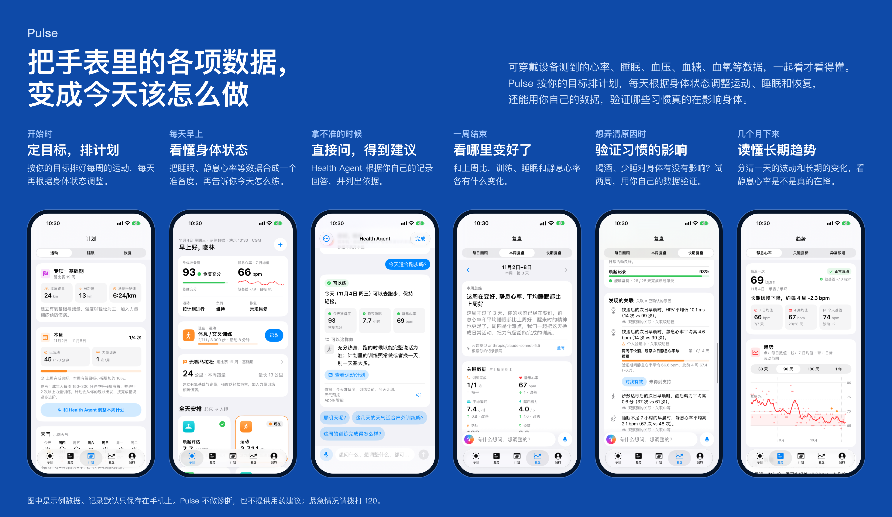

# Pulse

**把手表里的各项数据，变成今天该怎么做。**

可穿戴设备测到的心率、睡眠、血压、血糖、血氧等数据，一起看才看得懂。Pulse 按你的目标排计划，每天根据身体状态调整运动、睡眠和恢复，还能用你自己的数据，验证哪些习惯真的在影响身体。



Pulse 是 iPhone 和 iPad 上的中文应用，需要 iOS 18 或更新的系统，用 SwiftUI、SwiftData 和 HealthKit 编写。它还没有上架 App Store，目前要从源代码构建，见[运行](#运行)。

## 怎么用

| 什么时候 | 做什么 |
|---|---|
| 开始时 | 填写身体情况、生活节奏和目标，Pulse 排出第一周计划。没有手表也能用，可以手动记录。 |
| 每天早上 | 在「今日」看身体准备度：它综合睡眠、夜间心率、醒后感受和训练负荷，下面直接写着今天怎么练。 |
| 情况有变时 | 累了、加班、膝盖疼或天气不好，计划可以跟着调整。改动先显示修改前后的对比，采纳后才生效，也可以撤销。 |
| 拿不准的时候 | 问 Health Agent。它根据你的记录回答，并列出依据。 |
| 一周结束 | 在「复盘」和上周比较，采纳建议，生成下周计划。 |
| 想弄清原因时 | 复盘会找出习惯和身体指标的关联，比如喝酒后第二天静息心率偏高。点「开始验证」，试两周再看结果，确实有效才标为「已确认」。 |
| 几个月下来 | 分清一天的波动和长期的变化，看每个目标走到了哪个阶段。 |

## 读取哪些数据

Pulse 从 Apple 健康读取手表和其他设备写入的数据，只读不写：静息心率、心率、心率变异性、呼吸频率、血氧、血压、血糖、体重、睡眠、睡眠时的呼吸紊乱、步数、活动能量、锻炼时间、最大摄氧量、跑步和骑行距离、体能训练，以及心律不齐和心率过高、过低的提示。

## 页面

| 标签 | 内容 |
|---|---|
| **今日** | 今日状态、现在最该做的一件事、全天安排（晨起评估、运动、饮食与指标、睡前、全天回顾），以及血糖、血压、专项运动和本周进度。首页卡片可以自己调整。 |
| **趋势** | 静息心率（单次波动、持续变化和长期趋势，最长看 1 年）、关键指标（血压、CGM 连续血糖、夜间指标、化验结果）、异常跟进。 |
| **计划** | 运动（一周安排，有精简版和进阶版，可按天气调整）、睡眠（含睡眠呼吸筛查、就诊摘要、CPAP 跟进）、恢复（饮食、饮水、咖啡因、饮酒和压力）。 |
| **复盘** | 每日回顾；本周复盘（与上周比较、建议、三问复盘、下周计划）；长期复盘（各目标所处阶段、多维进展、习惯坚持、发现的关联、下一阶段）。底部随时可以问 Health Agent。 |
| **我的** | 健康档案、作息与倒班、专业支持、提醒、数据来源、记录历史、隐私与导出、回答方式与云端模型、示例用户。 |

## Health Agent

Pulse 的规则先读懂问题、算出结论和依据，再由大模型把回答写成自然的话。

- **先答你问的**：能不能吃、要不要紧、为什么、怎么办，都先直接回答。问题里的血压、血糖、体重、化验值、食物和症状都读得出来。
- **结论由规则决定**：今天或明天适不适合训练这类结论，来自你的记录和当前时间，大模型不能改。模型丢掉结论时，改用规则写的回答。
- **在对话里办事**：可以记下血压、血糖、体重、化验、饮水、饮食和运动，设置一次性或重复的提醒，调整运动计划。这些都先显示成卡片，确认后才生效，可以撤销。
- **计划修改有安全检查**：每周总时长最多增加 10%，至少留 1 天不训练，较高强度不相邻，准备度低的当天只安排低强度，未经医生确认不加较高强度，疼痛时只降强度或换低冲击方式。
- **复盘也由大模型撰写**：出现事实里没有的数字，或涉及调整用药时，那一段改用规则文字。卡片上注明是谁写的。
- **其他**：支持语音提问和朗读，可以撤回问题，也可以给 Health Agent 取名字。

回答方式在「我的 › 回答方式与云端模型」设置，默认是「仅本机」：

| 回答方式 | 谁来回答 | 发送什么 |
|---|---|---|
| 仅本机 | Apple 智能和 Pulse 规则 | 什么都不发送 |
| 端云结合 | Pulse 在本机分析，云端写回答；卡片、计划修改、结论和安全提示都留在本机 | 同意发送健康数据时，发送问题、分析要点和与问题有关的数据；不同意时只发通用问题 |
| 全部云端 | 云端模型回答所有问题，并撰写复盘 | 问题和数据摘要，需要同意发送健康数据 |

云端支持 OpenRouter、Anthropic 和 OpenAI 兼容接口，要自己提供 API 密钥，并通过连接测试。没有设置好时，Pulse 留在本机回答。每条回答下面都标出它在哪里回答。

## 针对不同情况

| 情况 | Pulse 做什么 |
|---|---|
| 慢性肾病与透析 | 限水、体重快速上涨提醒、化验结果（eGFR、血钾等）和复查提醒、肾病饮食、透析日安排 |
| 心血管 | 7 天家庭血压监测、服药依从、运动处方，心衰时跟进每天的体重 |
| 血糖 | CGM 达标时间、每日规律、餐后和运动反应、低血糖时段、血糖代谢画像 |
| 睡眠呼吸 | STOP-BANG 筛查、就诊摘要、CPAP 跟进 |
| 备赛 | 赛事可行性、训练负荷比、配速与心率区间、补给演练、乳酸阈值 |
| 倒班 | 按轮班周期划分一天，今日、复盘和 Health Agent 都跟着班次走，夜班当天和夜班后的恢复日不安排训练 |
| 其他慢性病 | 在对话中提到低血钾、高钾血症、痛风、骨质疏松、类风湿关节炎、癫痫、体位性心动过速或低血压时，按内置资料调整建议；点「记下」才写入档案 |

另外，血压和血糖可以看未来约 4 周的趋势范围和未来 1 小时的走向，这些预测不能用来计算胰岛素或药物剂量。雷雨、高温或空气差时，Pulse 建议把户外训练改到室内，或挪到天气好的一天。

## 隐私与安全

- 不需要账号。默认所有数据只保存在这台设备上，不上传到服务器。
- 只有选择了「端云结合」或「全部云端」，或者自己导出、分享时，数据才会离开设备。
- 发到云端之前，Pulse 在本机去掉姓名、电话、证件号、邮箱、地址、医院和医生，回答回到手机后再填回去。姓名靠上下文识别，没有「我叫」「医生」这类线索的名字可能认不出来。年龄、日期、城市和健康数据不会去掉。
- API 密钥保存在本机钥匙串，不会出现在导出的数据里。
- 可以导出就诊摘要（文本）、完整数据（JSON）和每日数据（CSV），并选择包含哪些内容。
- 「删除所有数据」会清除记录、对话、设置、云端密钥和发送健康数据的同意，不影响健康 App 里的数据。
- 紧急情况（胸痛、呼吸困难、晕厥等）直接给出固定提示，始终在本机回答，不经过大模型。

## 运行

**直接演示**：双击 `Demo/启动演示.command`，脚本会启动 iOS 模拟器并打开 Pulse，第一次运行时自动构建，约需 1–2 分钟。详见 [Demo/README.md](Demo/README.md)。

**开发**：用 Xcode 打开 `Pulse.xcodeproj`，选择 iPhone 或 iPad 模拟器运行。首次启动可以选「先用示例数据体验」。

**真机**：项目里没有写入开发团队，请在 Xcode 的 Signing & Capabilities 选择自己的团队。免费的个人团队也可以，但应用 7 天后会过期，需要重新安装。

**示例用户**（「我的 › 示例用户」或启动参数 `-PulsePersona`）：

| 用户 | 记录 | 情况 |
|---|---|---|
| 晓林 `xiaolin` | 120 天 | 39 岁，坚持得不错，静息心率从 74 降到 66，正在验证饮酒的影响 |
| 陈杰 `chenjie` | 120 天 | 45 岁，久坐超重，血压偏高，熬夜、饮酒多，计划常落空 |
| 林悦 `linyue` | 120 天 | 34 岁，倒班护士，作息混乱，记录断断续续 |
| 王建国 `wangjianguo` | 120 天 | 57 岁，2 型糖尿病和高血压，常漏服药，运动少 |
| 孙浩 `sunhao` | 1 年 | 重度睡眠呼吸暂停，使用呼吸机后静息心率、血压和体重慢慢下来 |
| 周敏 `zhoumin` | 1 年 | 血液透析（周一三五），限水，每月化验血钾、血磷 |
| 赵立强 `zhaoliqiang` | 1 年 | 心梗放支架后心衰，每天称体重，坚持心脏康复 |
| 何静 `hejing` | 1 年 | 1 型糖尿病，练半马，跑步后夜里偶有低血糖 |

**启动参数**：

| 参数 | 作用 |
|---|---|
| `-PulseDemo -PulseReset` | 载入示例数据，可加 `-PulsePersona chenjie` 指定用户 |
| `-PulseInMemory` | 使用不落盘的临时数据 |
| `-PulseTab heart\|plan\|review\|me` | 打开指定标签页 |
| `-PulseTime 07:40` | 把演示时间设为当天的这个时刻 |
| `-PulseSegment vitals\|events\|long\|day` | 打开指定分段（仅 Debug） |
| `-PulseOpen glucose\|cardio\|marathon\|agent\|nutrition\|evening\|review\|readiness\|cloud\|nextweek\|labs\|events` | 直接打开页面（仅 Debug） |
| `-PulseAsk "问题"` | 配合 `-PulseOpen agent` 自动提问（仅 Debug） |
| `-PulseTrainingToday` | 让示例数据的今天成为训练日（仅 Debug） |

**测试**：

```bash
xcodebuild -project Pulse.xcodeproj -scheme Pulse -destination 'platform=iOS Simulator,name=iPhone 17' test
```

连接真实云端模型和 Apple 智能的测试默认跳过，见 `PulseTests/CloudLiveTests.swift`。

## 代码结构

`Pulse/Engine/` 是不依赖存储的规则和分析，`Pulse/Data/` 负责数据读写和提醒，`Pulse/Features/` 是各个页面，`PulseTests/` 是单元测试。

| 功能 | 主要代码 |
|---|---|
| 个人基础与目标 | `Features/Onboarding/`、`Features/Profile/ProfileEditors.swift`、`Engine/GoalJourney.swift` |
| 静息心率趋势 | `Engine/RHRTrendAnalyzer.swift`、`Features/Heart/HeartView.swift` |
| 晨起状态与身体准备度 | `Engine/ReadinessEngine.swift`、`Engine/DailyFlow.swift`、`Features/Today/TodayMorning.swift` |
| 运动计划与当天调整 | `Engine/PlanGenerator.swift`、`Engine/PlanAdjuster.swift`、`Features/Plan/PlanView.swift`、`Features/Today/AdjustPlanView.swift` |
| 睡眠与睡眠呼吸 | `Engine/CareAnalyzers.swift`、`Features/Plan/SleepCareView.swift` |
| 日常习惯与恢复 | `Features/Plan/HabitsView.swift`、`Features/Today/EveningCheckInView.swift` |
| 身体指标与异常事件 | `Engine/AlertEngine.swift`、`Engine/VitalForecast.swift`、`Features/Heart/VitalsView.swift`、`Features/Heart/HealthEventsView.swift` |
| 复盘与习惯验证 | `Engine/ReviewEngine.swift`、`Engine/ReviewCoach.swift`、`Engine/ReviewCopy.swift`、`Features/Review/` |
| 记录、同步与导出 | `Features/Logging/QuickLogView.swift`、`Data/HealthKitService.swift`、`Data/DataExporter.swift`、`Features/Profile/HistoryView.swift` |
| 提醒 | `Data/CareReminders.swift`、`Data/BackgroundCheck.swift`、`Engine/CareRepeat.swift` |
| 专业支持 | `Features/Modules/`、`Engine/ProAnalyzers.swift`、`Engine/GlucoseProfile.swift` |
| 慢性病与化验 | `Engine/ConditionLibrary.swift`、`Engine/KidneyCare.swift`、`Engine/KidneyDiet.swift`、`Engine/LabResults.swift`、`Engine/LabRecheck.swift` |
| 倒班与天气 | `Engine/ShiftSchedule.swift`、`Engine/WeatherPlan.swift`、`Features/Plan/WeatherPlanCard.swift` |
| Health Agent：理解和回答问题 | `Engine/HealthAgent.swift`、`Engine/AgentQuestion.swift`、`Engine/AgentAnswers.swift`、`Engine/FoodGuide.swift`、`Engine/SymptomGuide.swift`、`Engine/TrainingCheck.swift` |
| Health Agent：操作和界面 | `Engine/ChatRecord.swift`、`Engine/PlanChat.swift`、`Engine/AgentUI.swift`、`Features/Agent/` |
| Health Agent：路由和隐私 | `Engine/AgentRouting.swift`、`Engine/IdentityMask.swift`、`Features/Agent/CloudModel.swift` |

## 已知限制

- **天气预报**：示例用户使用内置的示例天气。真实用户需要在 Xcode 中给 App 加上 WeatherKit 能力，并允许定位，否则 Pulse 会提示暂时拿不到预报。项目默认没有开启这项能力。
- **后台异常提醒**：由 iOS 决定什么时候运行，通常每隔几小时一次，手机锁定时读不到新的健康数据。它不能代替急救。
- **Apple 智能**：只在支持的设备上可用。不可用又没有设置云端模型时，回答标注「Pulse 规则分析（未经大模型）」并说明原因。

## 说明

Pulse 用于记录和理解个人健康数据，不做诊断，也不提供开始、停止或调整药物的建议。异常提示只用于提醒复测或寻求专业帮助，记录里看到的关联不等于原因。紧急情况请拨打 120。
